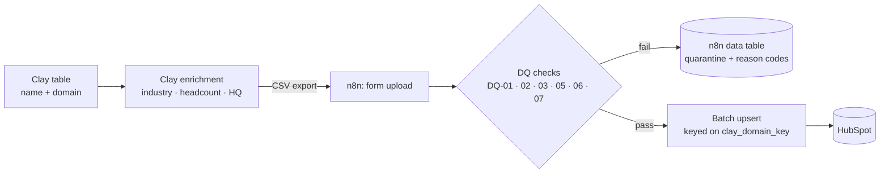

# GTM enrichment quality pipeline

A single go-to-market data workflow: **Clay** enriches a list of companies, **n8n** runs data-quality checks on every row, and only rows that pass reach **HubSpot**, as a create or update matched on domain. Rows that fail go to a quarantine table with a reason code, so you can see and fix bad data before it reaches the CRM.

> **Status:** week 2 of 3. n8n workflow, DQ-01..07 checks, industry mapping, `clay_domain_key` batch upsert and quarantine data table are live. Everything here is company-level and synthetic. The repo contains no personal contact data.

## Architecture



**Pull model.** n8n pulls the data; Clay never pushes. Clay's webhook sources and HTTP API column are Growth-plan features, and the Public API's table-read endpoint is Enterprise-only, so on the free plan rows leave Clay as a CSV export. No tunnel or public endpoint is needed: n8n runs locally in Docker.

## Data-quality rules

| ID | Check | Outcome | Reason code |
|---|---|---|---|
| DQ-01 | Name and domain present | Quarantine | `MISSING_REQUIRED` |
| DQ-02 | Domain format valid (after normalisation) | Quarantine | `INVALID_DOMAIN` |
| DQ-03 | Duplicate domain within the batch | Quarantine later copies | `DUPLICATE_IN_BATCH` |
| DQ-04 | Company already in HubSpot | Update, not create | — |
| DQ-05 | Headcount numeric when present | Quarantine | `HEADCOUNT_NOT_NUMERIC` |
| DQ-06 | Industry missing | Flag, still load | `INDUSTRY_MISSING` |
| DQ-07 | Industry present but not in mapping table | Flag, still load | `INDUSTRY_UNMAPPED` |

[`docs/rules.md`](docs/rules.md) has the full spec: evaluation order, domain normalisation, quarantine schema and the Clay → HubSpot field mapping.

## Repo layout

```
docs/rules.md                   DQ rule spec (source of truth for the n8n checks)
sample/companies_sample.csv     25 synthetic companies with seeded bad rows
sample/README.md                Expected result for every seeded row
scripts/hubspot_smoke_test.py   Service-key test + HubSpotClient with batch upsert
scripts/industry_mapping.py     Clay free-text industry → HubSpot picklist enum (148 entries)
tests/                          pytest, with all HubSpot calls mocked
n8n/workflow.json               n8n workflow export, credentials stripped
```

## Run steps

### Prerequisites

- Python 3.13, plus n8n running locally in Docker (`curl -s localhost:5678/healthz` returns `{"status":"ok"}`)
- A HubSpot account with a **service key** that has `crm.objects.companies.read` and `crm.objects.companies.write`. Use a service key, not a private app, because private apps are retired on new accounts.
- A Clay account. The free plan is enough, since data leaves Clay as a CSV export.

### Setup

```bash
pip install -r requirements.txt
cp .env.example .env   # then fill in HUBSPOT_SERVICE_KEY
pytest -q              # offline, no credentials needed
```

### HubSpot smoke test

```bash
python scripts/hubspot_smoke_test.py --search-only   # read scope only
python scripts/hubspot_smoke_test.py                 # search → create → wait for index → update → read back
python scripts/hubspot_smoke_test.py --archive       # same, then delete the test company
```

The test writes only to the synthetic domain `gtm-pipeline-smoke-test.example`. On the first run it creates the company, waits for HubSpot search to index it and reports the lag, then updates it. Later runs go straight to the update path.

### Pipeline run

1. Export the enriched Clay table as CSV.
2. Import `n8n/workflow.json` into n8n (localhost:5678).
3. Create an **HTTP Header Auth** credential in n8n named "HubSpot Service Key" with header `Authorization` = `Bearer <your-service-key>`.
4. Open the workflow and click **Execute workflow** — a form opens.
5. Upload the CSV file and submit.
6. Check results:
   - **Log Results** node shows created/updated counts.
   - The **Quarantine** data table (in n8n) holds failed rows with reason codes.

> **After import:** The quarantine `dataTableId` and the HubSpot HTTP Header Auth credential are instance-specific. Create the credential and data table in your n8n instance, then update the **Quarantine Table** and **HubSpot Batch Upsert** nodes to point to them.

## Demo

Week 3: a 2–3 minute walkthrough.

## Security

- Secrets live only in `.env` (git-ignored). `.env.example` lists the variable names with no values.
- The n8n workflow is exported with credentials stripped. The HubSpot credential is re-created in n8n by whoever runs it.
- Sample data is fictional and uses the reserved `.example` TLD. Live runs use public company-level data only, never personal contacts.
