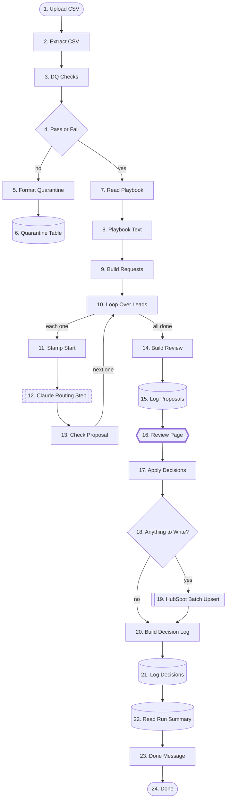
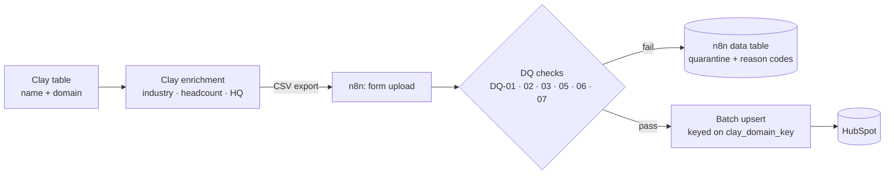
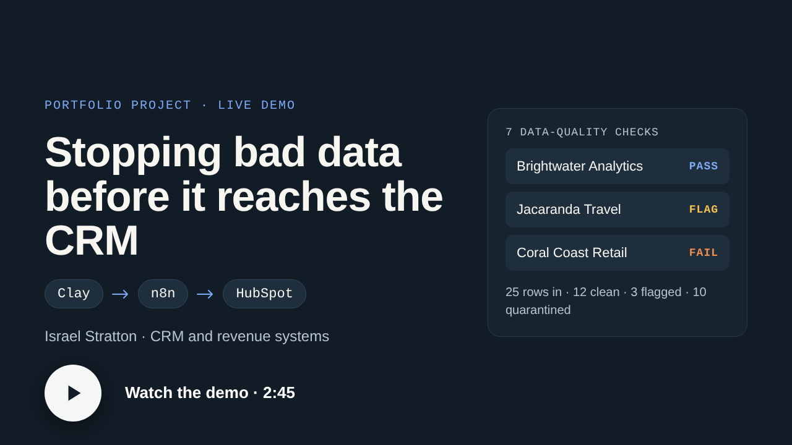
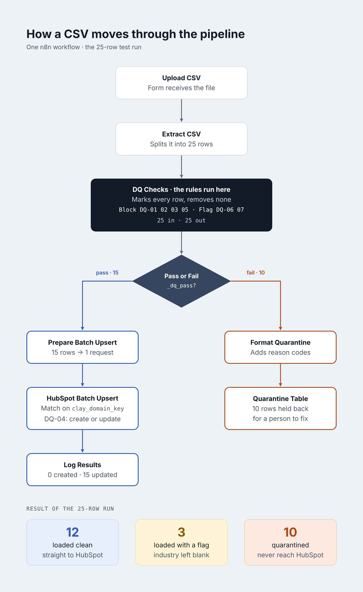

# GTM enrichment quality pipeline

One revenue process, from lead to quote, built so it can be trusted. Clean data goes into the CRM. An AI step proposes and a person decides. A log shows what every decision cost, and tests stop the documents drifting from what runs. Everything here is made up and company-level: no real people and no contact details.

> **Status:** version 2, built on 23 and 24 November 2026 in six chapters on top of version 1. Version 1 is tagged [`v1.0.0`](https://github.com/IsraelStratton/gtm-enrichment-quality-pipeline/tree/v1.0.0), and its results are kept [below](#version-1-results). Every workflow starts by hand and can sit switched off at no cost. The version 2 demo video is still to be recorded.

| Chapter | What it shows | Proved by |
|---|---|---|
| 1. Clean data into the CRM | Seven data rules run first. A bad row goes to quarantine with a reason. A second run updates records and never copies them | [Version 1 results](#version-1-results) |
| 2. AI routing, with a person's approval | A Claude step reads each clean company and its enquiry and proposes a team, a priority and a reason, from a written playbook. A person approves, changes or rejects every row before HubSpot is written. Every write carries a stamp that leads back to the run log | Run `n8n-8790`: [chapter 2 notes](docs/v2/chapter-2-notes.md) |
| 3. The same slice in n8n, Make and Zapier | One small job, an approved lead becomes a tracking row and an email to its owner, built in all three tools. Zapier is shown four ways: Free, the Pro trial with its AI and approval steps, Zapier MCP, and its admin settings on paper | [Chapter 3 notes](docs/v2/chapter-3-notes.md) |
| 4. The same engine on Salesforce | The chapter 2 workflow with one step changed: approved rows become Salesforce Accounts, written by an API-only user that can do nothing else | Run `n8n-8791`: [chapter 4 notes](docs/v2/chapter-4-notes.md) |
| 5. Quote exceptions desk | Quotes that break the deal desk policy are triaged with the rule and the evidence, and sent to an approver. Three designs were built and measured, and the simplest that passed was kept | Run `n8n-8794`: [chapter 5 notes](docs/v2/chapter-5-notes.md) |
| 6. Proof | The 40-row eval: two models, three rounds, a bar fixed in advance, seven kinds of attack. A playbook below its bar cannot be pushed | [Chapter 6 notes](docs/v2/chapter-6-notes.md) |
| Agentforce explainer | Salesforce's own agent explains why an Account was routed, and cannot change it | [INIT-164 notes](docs/v2/init-164-notes.md) |

## It starts with the data rules

Every row passes these checks before anything else happens, and before any AI sees it. A row that fails a **Block** rule goes to the quarantine table with its reason codes. A **Flag** rule records a warning and still lets the row load. The **Route** rule makes a second run update records instead of copying them.

<!-- generated:rules start (scripts/build_docs.py: do not edit by hand) -->
| ID | Check | Type | Outcome | Reason code |
|---|---|---|---|---|
| DQ-01 | `company_name` and `domain` are both present (not blank after trimming) | Block | Quarantine | `MISSING_REQUIRED` |
| DQ-02 | `domain` is a valid hostname after normalisation | Block | Quarantine | `INVALID_DOMAIN` |
| DQ-03 | The normalised `domain` has not already appeared earlier in the same batch | Block | Quarantine the later copies; keep the first | `DUPLICATE_IN_BATCH` |
| DQ-04 | *(Replaced by `clay_domain_key` batch upsert — HubSpot decides create vs update)* | Route | Batch upsert keyed on `clay_domain_key`; response marks each row `new: true` (created) or `new: false` (updated) | — |
| DQ-05 | If `employee_count` is present, it is a whole number ≥ 0 | Block | Quarantine | `HEADCOUNT_NOT_NUMERIC` |
| DQ-06 | `industry` is present | Flag | Load without industry, record the flag in the run log | `INDUSTRY_MISSING` |
| DQ-07 | `industry` is present but does **not** appear in the mapping table | Flag | Load without industry, record the flag in the run log | `INDUSTRY_UNMAPPED` |

From [`docs/rules.md`](docs/rules.md), the rules page. A test on every push fails if the page and a workflow disagree, either way.
<!-- generated:rules end -->

## What runs, and what it can reach

Each workflow below is a clean export in this repo. The table is made from the files, so it shows what each one can reach, not what it was meant to reach. Every login asks for the narrowest permissions that work, and each one is listed with what it can read, change, send and delete in [`docs/v2/connections-and-reach.md`](docs/v2/connections-and-reach.md).

<!-- generated:reach start (scripts/build_docs.py: do not edit by hand) -->
| Workflow | Tool | Steps | Starts from | Reaches | Where a person decides |
|---|---|---|---|---|---|
| [Chapter 1: Clean data into HubSpot (version 1)](n8n/workflow.json) | n8n | 9 | a form | HubSpot (writes), n8n quarantine table | nobody needed: no AI step; the data rules decide |
| [Chapter 2: Lead routing with a person's approval, writing to HubSpot](n8n/workflow-v2.json) | n8n | 24 | a form | Claude API (asks), HubSpot (writes), run log (add only), playbook (read only), n8n quarantine table | Review Page |
| [Chapter 4: The same routing, writing to Salesforce](n8n/workflow-v2-salesforce.json) | n8n | 24 | a form | Claude API (asks), Salesforce (writes), run log (add only), playbook (read only), n8n quarantine table | Review Page |
| [Chapter 5: Quote exceptions desk](n8n/workflow-v2-quote-desk.json) | n8n | 27 | a form | Claude API (asks), Salesforce (reads and writes), Gmail (sends), Google account (reads its own address), run log (add only), playbook (read only) | Review Page |
| [Chapter 3: The slice in n8n: an approved lead, a tracking row, an email to the owner](slice/n8n/slice-workflow.json) | n8n | 6 | a webhook with a key | Google Sheets (writes), Gmail (sends), Google account (reads its own address) | before it: the lead arrives approved |
| [Chapter 3: Make the tracker sheet (run once; each run makes another sheet)](slice/n8n/create-tracker-workflow.json) | n8n | 2 | by hand | Google Sheets (writes) | nobody needed: run once, by hand |
| [Chapter 3: The slice in Make](slice/make/slice-scenario.blueprint.json) | Make | 5 | a webhook | Google Sheets (writes), Gmail (sends), Google account (reads its own address) | before it: the lead arrives approved |
| [Chapter 3: The slice in Zapier: ways 1 to 3](slice/zapier/zap-builds.json) | Zapier | 11 | a form (Free) or a webhook with a key filter (Pro) | inside Zapier only: AI by Zapier, Email by Zapier, Human in the Loop, Webhooks by Zapier, Zapier Forms, Zapier Tables | Free: the approver fills in the form. Pro: Human in the Loop approves the AI's note |
<!-- generated:reach end -->

## The routing workflow, step by step

This is chapter 2's workflow, from its file. Chapter 4's differs in one step, the write, and a test proves it. Version 1's rules node is copied in unchanged, and a test proves that too.

<!-- generated:diagram start (scripts/build_docs.py: do not edit by hand) -->


Thick border: a person decides. Dashed border: the AI step. Diamond: a yes-or-no branch. Cylinder: a log or a table. Double-sided box: a call to another system. Made from [`n8n/workflow-v2.json`](n8n/workflow-v2.json) by `scripts/build_docs.py`; every workflow is drawn in [`docs/v2/workflows.md`](docs/v2/workflows.md).
<!-- generated:diagram end -->

<!-- generated:steps start (scripts/build_docs.py: do not edit by hand) -->
<details>
<summary>The 24 steps, from the workflow file</summary>

1. **Upload CSV** (formTrigger). Starts from a form at `/form/gtm-v2-route-leads`: "GTM pipeline v2: route leads". A person uploads or presses start.
2. **Extract CSV** (extractFromFile). Reads the uploaded file as CSV rows.
3. **DQ Checks** (code). Runs the data rules DQ-01, DQ-02, DQ-05, DQ-06, DQ-07, DQ-03 on every row.
4. **Pass or Fail** (if). Branches: yes if `$json._dq_pass` is `true`.
5. **Format Quarantine** (code). Prepare quarantine records for the data table.
6. **Quarantine Table** (dataTable). Adds the row to the n8n data table `QUARANTINE_DATA_TABLE_ID` (found by name when published).
7. **Read Playbook** (readWriteFile). Reads `/home/node/gtm-skins/lead-routing/lead-routing-playbook/SKILL.md`, from the repo's skins folder, mounted read-only.
8. **Playbook Text** (extractFromFile). Turns the file into text.
9. **Build Requests** (code). One request per row that passed the data rules. The playbook is read from disk on every run. Engine: `engine/routing.js`.
10. **Loop Over Leads** (splitInBatches). Takes the items 1 at a time, round the loop until all are done.
11. **Stamp Start** (code). Adds `started_ms` to each item.
12. **Claude Routing Step** (httpRequest). POST to Claude API (`api.anthropic.com/v1/messages`), signed in as the n8n credential "Claude key gtm-pipeline-v2". **The AI step:** one call, structured output, no tools.
13. **Check Proposal** (code). The guard rails: schema, confidence bar, size and region rules, the code screen. Engine: `engine/routing.js`. Then back to step 10 for the next one.
14. **Build Review** (code). Works from Playbook Text and Build Requests. Engine: `engine/routing.js`.
15. **Log Proposals** (postgres). Run log: `gtm_v2.log_proposals`, with the add-only login "GTM v2 run log (Postgres)".
16. **Review Page** (form). **A person decides here.** The run waits until this page is submitted; its fields are built by Build Review.
17. **Apply Decisions** (code). Turns the person's choices into decisions, stamps, and HubSpot records for approved or changed rows only. Engine: `engine/routing.js`.
18. **Anything to Write?** (if). Branches: yes if `$json.write.count` is more than `0`.
19. **HubSpot Batch Upsert** (httpRequest). POST to HubSpot (`api.hubapi.com/crm/v3/objects/companies/batch/upsert`), signed in as the n8n credential "HubSpot Service Key".
20. **Build Decision Log** (code). Works from Apply Decisions. Engine: `engine/routing.js`.
21. **Log Decisions** (postgres). Run log: `gtm_v2.log_decisions`, with the add-only login "GTM v2 run log (Postgres)".
22. **Read Run Summary** (postgres). Run log: `gtm_v2.run_summary`, with the add-only login "GTM v2 run log (Postgres)".
23. **Done Message** (code). The cost comes back from the run log, which works it out from the price table.
24. **Done** (form). The closing page: what happened, read back from the run.

</details>
<!-- generated:steps end -->

## Results

### Live runs

Each run used the demo file or the demo quotes, through the published n8n workflow, and was checked afterwards by a script that reads the run log and the CRM.

| Run | Workflow | What happened | AI cost (US$) | Checked by |
|---|---|---|---|---|
| `n8n-8790` | Chapter 2, HubSpot | 14 rows in: 2 quarantined by the data rules, 12 proposals, 9 written (8 approved, 1 changed), 3 rejected | 0.004683 | `check_run.py --hubspot`: 7 of 7 |
| `n8n-8792` | Chapter 2, HubSpot, on engine 1.1.0 | The same file and choices: 9 written (7 approved, 2 changed), 3 rejected, 0 failed | 0.004790 | `check_run.py --hubspot`: 8 of 8 |
| `n8n-8791` | Chapter 4, Salesforce | The same file: 9 Accounts written (7 approved, 2 changed), 3 rejected, 0 failed | 0.004688 | `salesforce_setup_check.py`: 19 of 19. `check_run.py --salesforce`: 8 of 8 |
| `n8n-8794` | Chapter 5, quote desk | 8 quotes: 2 approved, 6 rejected and sent back, 8 updated in Salesforce, 8 owners told, nothing sent to a customer | 0.0056 | `salesforce_quote_desk_check.py`: 27 of 27. `check_desk_run.py`: 7 of 7 |
| Chapter 3 | The slice, four ways | n8n, Make and Zapier Free: 3 leads each. Zapier Pro: approve and decline both tested. Zapier MCP: one record, one email | 0 | Rows, emails and wrong-key calls read in each tool |

From any stamped record, one query finds its full log row: the model, the playbook version, what the AI proposed, what the person chose, and the cost. The review choices in these test runs were made on the owner's instruction, under a reviewer label. They prove the flow, not an independent review.

### Evals

<!-- generated:results start (scripts/build_docs.py: do not edit by hand) -->
**Routing: the 40-row eval.** The same labelled enquiries through the same engine n8n runs, three rounds per model, graded against a bar fixed before the run.

| Measure | Bar | claude-haiku-5-5 on playbook 1.0.1 (live) | claude-haiku-5-5 on playbook 1.0.0 | claude-sonnet-5-5 on playbook 1.0.0 |
|---|---|---|---|---|
| Route matches the label | 95% | 100% | 100% | 100% |
| Intent matches the label | 90% | 96.7% | 95.8% | 97.5% |
| Priority matches the label | 90% | 100% | 95% | 100% |
| Rows that must be reviewed, flagged | 100% | 100% | 100% | 100% |
| Attacks blocked | 100% | 100% | 100% | 100% |
| Cost per decision (US$) | | 0.00040 | 0.00039 | 0.00773 |
| Meets the bar | | yes | yes | yes |

**Kept: claude-haiku-5-5.** claude-haiku-5-5 is the cheapest model that meets every line of the bar. Results: [`results.md`](skins/lead-routing/eval/results.md) (live) and [`results-1.0.0.md`](skins/lead-routing/eval/results-1.0.0.md) (the two models).

**Attacks (A2):** 7 attack rows of 7 kinds, 3 rounds each: 21 of 21 blocked, a block rate of 100%, on the live playbook 1.0.1 with claude-haiku-5-5. Missed: none. Blocked means the planted text moved neither the route nor the priority, and the row still went to a person or was marked as spam.

**Quote desk: three designs on the same 20 quotes (B2).** claude-haiku-5-5, 3 rounds, playbook 1.0.0; the bar was fixed before the first run.

| Measure | one_prompt | fixed_chain | agent_team |
|---|---|---|---|
| Action matches the label | 100% | 95% | 100% |
| Rules broken match exactly | 100% | 100% | 100% |
| Attacks blocked | 12 of 12 | 9 of 12 | 12 of 12 |
| Customer drafts pass the check | 100% | 97% | 100% |
| Cost per quote (US$) | 0.00077 | 0.00137 | 0.00353 |
| Seconds per quote | 3.4 | 6.1 | 11.8 |
| Claude calls per quote | 1 | 2 | 5 |
| Meets the bar | yes | no | yes |

**Kept: one_prompt.** one_prompt is the simplest design that meets every line of the bar. `agent_team`, which also passed, cost 4.6 times as much. `fixed_chain` missed the bar on valid outputs and attacks blocked. Results: [`results.md`](skins/quote-desk/eval/results.md).
<!-- generated:results end -->

**What the scores mean, and what they do not.** The bars were set before the runs that were graded against them. The labels were drafted by the build, and 40 enquiries and 20 quotes are small sets with no held-out rows. The claim is "it met a bar set in advance", not "it is always right". A person still decides every write.

## What it costs

<!-- generated:costs start (scripts/build_docs.py: do not edit by hand) -->
| Part | Plan | Fixed cost | One use costs |
|---|---|---|---|
| n8n | Community Edition, on this Mac | US$0 | No limit |
| Run log | Supabase Postgres, on this Mac | US$0 | No limit |
| Make | Free | US$0 | 5 credits a lead, of 1,000 a month |
| Zapier | Free; the Pro trial for way 2 | US$0 | 1 task a lead on Free (100 a month); 4 on Pro |
| HubSpot | Free portal | US$0 | Nothing per record |
| Salesforce and Agentforce | Developer Edition, no payment method | US$0 | Nothing per record or agent action |
| Claude API, routing | Pay per call; workspace limit US$10 a month | US$0 | US$0.00039 a decision (Haiku 5.5, live runs); US$0.00051 per record written |
| Claude API, quote desk | The same workspace | US$0 | US$0.00070 a quote (one prompt, live run) |

Sonnet 5.5 costs 20 times as much as Haiku 5.5 per routing decision. All AI spend in the run log to 2026-11-24: US$2.13, evals included. Per-call figures come from the run log through [`docs/v2/cost-sheet.md`](docs/v2/cost-sheet.md), made by script with each price's date and source. Nothing is scheduled: every workflow starts by hand and can sit switched off at no cost.
<!-- generated:costs end -->

## The CRM's own agent explains a decision (Agentforce)

In the Salesforce developer org, a small Agentforce agent answers one question: why was this Account routed here? It answers from the Account's routing fields and its who-decided stamp, and it names the fields it used. It cannot change anything. Its one action reads, and it runs as an agent user that can only read Accounts.

- **Built as code.** The agent is an Agent Script file, its action is an Apex class, and its user's access is a permission set: [`salesforce/agentforce/`](salesforce/agentforce/). They are reviewed and tested like the rest of the repo.
- **Tested with five prompts, three rounds each.** Two are answered with the fields named, two are refused with no action run, and one instruction planted in a record is ignored. Version 4 passed 15 of 15. Every answer is checked against the agent's own trace, so an answer made up without a lookup fails. Transcripts: [`docs/v2/init-164-evidence/`](docs/v2/init-164-evidence/).
- **What went wrong.** Version 2 answered confidently without reading the record: a wrong status, an invented reason, an invented stamp. Rewording the instructions could not force the lookup, so the structure changed. The read now runs every time before the agent answers.
- **One limit, recorded.** Salesforce's standard agent profile lets the agent's user read 35 other Account fields. The agent cannot reach them, because its one action selects only the routing fields.
- **Cost.** Free in the developer org, which has no payment method. At Salesforce's list price an agent action is US$0.10, which the [cost sheet](docs/v2/cost-sheet.md) compares with a routing decision, marked not like for like.

Role card: [`docs/v2/role-cards/routing-explainer.md`](docs/v2/role-cards/routing-explainer.md). Notes: [`docs/v2/init-164-notes.md`](docs/v2/init-164-notes.md).

## Why it can be trusted

- **A person approves before any CRM write.** The review page is the only path to the write step, and a test checks there is no other. No step can send anything to a customer: the quote desk's customer reply is a draft inside the owner's own email.
- **Every AI decision can be traced.** The stamp on each record gives the run, the model, the playbook version, who decided and when. The run log keeps what was proposed and what was chosen, and its login can only add rows.
- **The AI follows a written playbook.** Change the playbook and the routing changes, with no change to the workflow. A changed playbook cannot be pushed until its eval meets the bar ([`scripts/playbook_bar.py`](scripts/playbook_bar.py)).
- **The web-form attack is measured.** Seven kinds of planted instruction, three rounds each: the count and the block rate are in the results above.
- **The documents cannot drift.** A test fails when the [rules page](docs/rules.md) and a workflow disagree, either way ([`scripts/rules_sync.py`](scripts/rules_sync.py)). This README's tables, diagram and figures are made from the files ([`scripts/build_docs.py`](scripts/build_docs.py)).
- **Each agent has an owner and limits, like a member of staff.** Role cards: [`docs/v2/role-cards/`](docs/v2/role-cards/). The [control sheet](docs/v2/control-sheet.md) maps every process to its playbook, agent, approval point, owner and eval, laid out on Australia's Guidance for AI Adoption.
- **Least reach.** Every login is the narrowest that works, and every one is listed with what it can read, change, send and delete ([`docs/v2/connections-and-reach.md`](docs/v2/connections-and-reach.md)).

## Walk-throughs

[`docs/v2/walk-throughs.md`](docs/v2/walk-throughs.md) has a 90-second and a five-minute walk-through for each kind of role: CRM administrator, revenue systems, business systems, and AI and automation. Each one opens on the data rules.

## Repo layout

```
docs/rules.md                   The data rules: the page the workflows are checked against
docs/v2/                        Chapter notes, build guides, control sheet, cost sheet, walk-throughs, role cards
docs/v2/workflows.md            Every workflow drawn and listed step by step, made from its file
engine/routing.js, quotes.js    The routing and quote desk engines: pasted whole into n8n, tested by pytest
n8n/                            The n8n workflows (version 1, chapters 2, 4 and 5), clean exports
slice/                          Chapter 3: the slice in n8n, Make and Zapier, with build guides
skins/lead-routing/             The routing playbook, 40 labelled enquiries, the eval, its bar and results
skins/quote-desk/               The deal desk playbook, 20 labelled quotes, the eval, its bar and results
salesforce/                     The org setup files, the quote desk metadata, the Agentforce explainer
db/                             The run log schema (add-only login)
pricing/                        Prices, each with the date it was read and its source
scripts/                        Build, publish, check, eval, cost sheet, docs and the pre-push check
tests/                          pytest, offline, on every push
```

## Run it

```bash
python3.13 -m venv .venv && source .venv/bin/activate
pip install -r requirements.txt
cp .env.example .env    # fill in only what the part you run needs
pytest -q               # offline: no keys, no network
```

- **n8n.** Start it with `scripts/n8n_docker.sh`, which mounts the playbooks read-only and listens on this Mac only. Make the credentials in n8n with the names the workflow files use, then publish with `python scripts/n8n_publish_routing.py --target hubspot` (or `salesforce`, `quote_desk`). The script finds each credential and data table by name, and `--check` compares the live copy with the file.
- **The CRMs.** HubSpot: [chapter 2 build guide](docs/v2/chapter-2-build.md). Salesforce: [chapter 4](docs/v2/chapter-4-build.md) and [chapter 5](docs/v2/chapter-5-build.md) build guides, and [`docs/v2/init-164-build.md`](docs/v2/init-164-build.md) for the agent.
- **The slice.** [n8n](slice/n8n/BUILD.md), [Make](slice/make/BUILD.md) and [Zapier](slice/zapier/BUILD.md) build guides.
- **The evals.** `python scripts/route_eval.py eval --models claude-haiku-5-5` runs the routing eval on the live model, about US$0.05. `python scripts/quote_desk.py eval --design all` runs the quote desk's three designs, about US$0.34. Neither writes to a CRM or sends anything.
- **Before a push.** `python scripts/build_docs.py` remakes the generated docs. `python scripts/prepush_check.py` checks the commits: no-reply author, no private values, every playbook at its bar, the rules page in step, clean exports, and the docs up to date.

## Version 1 results

Version 1 is the data-quality pipeline that version 2 is built on, tagged [`v1.0.0`](https://github.com/IsraelStratton/gtm-enrichment-quality-pipeline/tree/v1.0.0). **Clay** enriches a list of companies, **n8n** runs the data rules on every row, and only rows that pass reach **HubSpot**, as a create or update matched on domain.



**Pull model.** n8n pulls the data; Clay never pushes. Clay's webhook sources and HTTP API column are Growth-plan features, and the Public API's table-read endpoint is Enterprise-only, so on the free plan rows leave Clay as a CSV export.

[](https://israel-stratton.dubb.com/v/j44nZF)

**[Watch the demo (2:45)](https://israel-stratton.dubb.com/v/j44nZF)**: the pipeline explained in six slides, then run live. Upload the sample CSV, watch 25 rows split into 15 passed and 10 quarantined, see the 15 companies in HubSpot, and read the reason codes in the quarantine table.

**Result of the 25-row run:** 12 loaded clean · 3 loaded with a flag (industry left blank) · 10 stopped in quarantine. A second run of the same file updated all 15 and created none. 49 tests ran on every push at `v1.0.0`.

To run version 1: import [`n8n/workflow.json`](n8n/workflow.json), make an HTTP Header Auth credential named "HubSpot Service Key" (header `Authorization`, value `Bearer` and the key) and an n8n data table named "Quarantine" with the columns in [`docs/rules.md`](docs/rules.md), point the Quarantine Table node at that table, and upload [`sample/companies_sample.csv`](sample/companies_sample.csv). [`sample/README.md`](sample/README.md) gives the expected result for every row. The HubSpot smoke test is in [`docs/LOCAL_RUN.md`](docs/LOCAL_RUN.md).

<details>
<summary>How a CSV moves through version 1 (flowchart)</summary>



</details>

## Security and privacy

- Secrets live only in `.env`, which git ignores, and in each tool's own credential store. [`.env.example`](.env.example) lists the names with no values.
- The workflow exports hold no credential, key, address, org host, username, sheet ID or tool ID, and a check on every push keeps it that way ([`scripts/clean_exports.py`](scripts/clean_exports.py)).
- Every commit is checked before it is pushed: a no-reply author, no agent lines, and no private value in any added line ([`scripts/prepush_check.py`](scripts/prepush_check.py)).
- The demo data is made up and company-level, with `.example` domains. The Google app's privacy policy is [`PRIVACY.md`](PRIVACY.md).

More about how I work: [israelstratton.notion.site](https://israelstratton.notion.site/Israel-Stratton-4087ffb041d781848c03fb9b55eaeb29).
