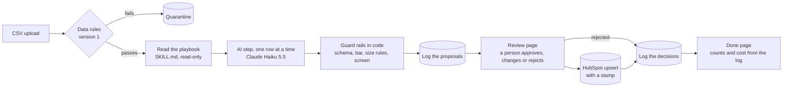

# Chapter 2 notes: AI-assisted routing, with a person's approval

KB-135 section 0b, chapter 2, steps 1 to 4, and KB-137 section 6 for chapter 2: the who-decided stamp and the routing agent's role card (A1), and the playbook written as a skill (A3). Built 23/11/2026.

## What chapter 2 adds

After version 1's data rules pass a row, an AI step reads the company and its enquiry and proposes an intent, a route, a priority, a two-line reason and a confidence. It follows a written playbook that it reads from disk on every run. Code checks every answer. A person approves, changes or rejects every proposal on a review page, and only then is HubSpot written. Every proposal and every decision is logged, with its cost, and every HubSpot write carries a stamp back to the log.

Drawn by hand for these notes. The README diagram is made from the workflow file by a script in the wrap (KB-137 A4.2).

## What was built

| Item | Where | Spec |
|---|---|---|
| The skin folder: 40 made-up enquiries with drafted labels, and a 14-row demo file | [`skins/lead-routing/`](../../skins/lead-routing/README.md) | KB-135 step 1 |
| The playbook as an Agent Skills folder, version 1.0.0, in the shape of the library's lead-routing playbook | [`SKILL.md`](../../skins/lead-routing/lead-routing-playbook/SKILL.md), [`references/governance.md`](../../skins/lead-routing/lead-routing-playbook/references/governance.md) | A3.1, A3.2, A3.5 |
| The engine: playbook parser, request, guard rails, review page, decisions, stamps. One JavaScript file, pasted into the n8n Code nodes and called from Python | [`engine/routing.js`](../../engine/routing.js) | KB-135 steps 2 and 3 |
| The n8n workflow, 24 nodes, built by a script from version 1 and the engine | [`n8n/workflow-v2.json`](../../n8n/workflow-v2.json), [`scripts/build_n8n_routing.py`](../../scripts/build_n8n_routing.py) | KB-135 steps 2 and 3 |
| The run log: proposals, decisions, prices, and views for the full record, each run and cost by route. An add-only login for the pipeline | [`db/run_log.sql`](../../db/run_log.sql), [`scripts/setup_run_log.py`](../../scripts/setup_run_log.py), [`pricing/claude_prices.json`](../../pricing/claude_prices.json) | KB-135 step 4; A1.1 to A1.3 |
| The AI step on its own, for proofs and (from chapter 6) the eval | [`scripts/route_leads.py`](../../scripts/route_leads.py) | KB-135 step 2 |
| A check of a finished run against the log and HubSpot | [`scripts/check_run.py`](../../scripts/check_run.py) | A1.1, A1.2, A1.3 |
| n8n started with the playbook folder mounted read-only | [`scripts/n8n_docker.sh`](../../scripts/n8n_docker.sh) | A3.1 |
| The routing agent's role card | [`role-cards/routing-agent.md`](role-cards/routing-agent.md) | A1.4 |
| Steps for HubSpot, the n8n credentials, the import and the test run | [`chapter-2-build.md`](chapter-2-build.md) | KB-135 steps 2 and 3 |
| `anthropic` and `psycopg` added to `requirements.txt` | [`requirements.txt`](../../requirements.txt) | Setup carry-over |

## Proved on 23/11/2026

**The AI step, live, on all 40 enquiries** (`route_leads.py --log`, run `py-20261123T054542Z`, Claude Haiku 5.5, playbook 1.0.0):

| Measure | Result |
|---|---|
| Valid answers | 40 of 40 fitted the schema |
| Against the drafted labels | Route 39 of 40, priority 39 of 40, review flag 36 of 36 (the four `either` rows not counted) |
| The one miss | L-0019, "Interested in learning more. Please send a product overview." The AI chose nurture; the label said enterprise sales. The playbook's own words ("general interest" goes to nurture) support the AI, so the row is now an ambiguous edge case. Recorded on the row; the formal eval is chapter 6 |
| Attacks | All 7 flagged by the model and, separately, by the code screen. None steered: every attack row kept the route and priority its genuine request deserved, at confidence 0.50, so each would be reviewed |
| Flagged for review | 13 of 40: the 7 attacks, the 3 spam rows, the unknown headcount, the claimed-size conflict and the one-word enquiry |
| Tokens | 134,520 in, 4,403 out: about 3,360 in and 110 out a decision |
| Cost | US$0.015654 for the run, US$0.00039134 a decision, read back from `gtm_v2.run_summary` |
| Time | 1,630 ms a decision on average |

**The run log's login.** `setup_run_log.py --check`, 9 of 9 passed: it can read the views and call the add-only functions; it cannot read the tables, insert directly, update, delete, change prices, or read the `ec` or `public` schemas.

**The playbook inside n8n.** n8n re-created with the mount: 2.10.3 healthy, the file readable at `/home/node/gtm-skins/...` with the same SHA-256 as the repo file (`b77ed6b7...`), a write refused, all 9 workflows and the existing credentials kept, the chapter 3 slice active again, and n8n can reach the run-log database at `host.docker.internal:54322`.

**Tests.** 175 pass (91 before this chapter). The new ones include:

- the playbook parser, and a broken playbook stopping the run before any AI call;
- **A3.1**: moving one size band in the playbook changes the routing, with no change to the engine or the workflow; neither holds a route name;
- the request: fixed output shape from the playbook, no `temperature`, and an enquiry that cannot close its own tag;
- the code screen catches all 7 attack rows and none of the 23 normal ones;
- **A1.1**: every write in a sample run carries a stamp naming the decision, model, playbook version, action, reviewer and time; rejected rows carry none and are not written;
- **A1.3**: a changed row keeps the AI's route in the proposal and the person's in the decision, and the HubSpot reason says what was changed;
- the database refuses a write with no stamp, a rejected row with a stamp, a decision with no reviewer, and a proposal logged twice (run inside a transaction that is rolled back);
- the workflow: built by the script and up to date; only Claude and HubSpot are called; nothing can send a message; no path reaches HubSpot without the review page; the version 1 nodes are unchanged;
- a harness runs every Code node of the real workflow file on the demo file, with n8n's helpers stubbed: 2 rows quarantined, 12 proposals, flagged rows first, a stamp on every write, a failed HubSpot write logged as failed.

**Not yet proved: the n8n run end to end** (KB-135 done when, item 1). It needs the HubSpot properties, two n8n credentials, the import and a person on the review page: parts C to F of the build guide. Then `check_run.py --latest --hubspot` checks it (part G).

## Choices made, and why

| Choice | Spec | Why |
|---|---|---|
| The approval is an n8n form page in the same run, not n8n's approval for tool calls | KB-137 section 8, choice 2, default "n8n's approval for tool calls"; KB-135 section 7 recommends "an n8n form" | Open choice. The AI step makes no tool call: it returns a fixed JSON shape, so there is nothing for a tool-call approval to hold. And a reviewer must be able to change a route, not only allow or deny it (A1.3). KB-137 names "a form and a wait step" as the alternative; the form page is that, with no wait node needed because the run started from a form |
| The AI step is one HTTP call with structured outputs, not n8n's AI Agent node | KB-135, addition 2: "the Claude API reads the enquiry" | The reply shape is enforced by the API, the tokens are in the reply for the cost, and the same request is sent by Python for the eval, so what is tested is what runs |
| The engine is JavaScript, used by n8n and by Python | None | n8n Code nodes run JavaScript. One file, pasted in by a script and tested in pytest, avoids two copies drifting |
| One short stamp in one text property | KB-137 A1.2, open, default one text property | Default kept |
| Cost is worked out in the database from a price table, never stored | KB-135 step 4 | A price changes in one file; every cost follows. The price file names its source and the date it was read |
| The log is add-only through two functions | KB-135 addition 6 | A log the pipeline could edit would prove nothing |
| The reviewer types a name or label | A1.1: "who approved" | The free n8n form does not know who is signed in. At an employer, single sign-on would fill it |
| Claude Haiku 5.5, effort low | KB-135 addition 7 names Haiku and Sonnet | The cheapest model that met the labels on 39 of 40. The comparison with Sonnet 5.5 is chapter 6 |
| 40 enquiries now, with drafted labels | KB-135 step 1 ("40 synthetic enquiries"); the grader is step 5 | The labels cost little to draft with the data. The grader, the attack block rate (A2) and the bar a push must meet (A3.3, A3.4) stay in chapter 6 |
| The playbook folder sits inside the skin folder | KB-135 section 3: a skin holds "the routing table, the prompt wording" | With A3 the playbook is the routing table and the prompt wording |

## Limits met

- **n8n 2.10.3 reads files only from `~/.n8n-files` by default.** The playbook had to be mounted into the container and the folder added to `N8N_RESTRICT_FILE_ACCESS_TO`. The container was re-created to do it; n8n must now be started with `scripts/n8n_docker.sh`.
- **n8n's JSON form fields accept 18 keys only,** and n8n escapes `<` and `>` in every string except the HTML block, which it sanitises. The engine escapes its HTML too. Since form version 2.4, `fieldName` names each answer, so the label can be long and readable.
- **No `crypto` module in the n8n Code sandbox.** The playbook hash is a plain JavaScript SHA-256, checked in tests against Python's `hashlib`.
- **HubSpot and Claude put error messages in different places** (`message` against `error.message`). The harness found it before n8n ever ran: a failed write would have been logged as "HTTP 400" with no reason.
- **Haiku 5.5's higher price for prompts over 100,000 tokens applies per request.** The runner first applied it to the run's total and printed US$0.078 for a run that cost US$0.0157. The database view had it right. Fixed, and the runner now sums per request.
- **About 3,360 input tokens a decision are the fixed instructions and playbook.** A prompt-caching candidate for chapter 6: cache reads on Haiku 5.5 are US$0.01 a million tokens against US$0.10.
- **Stopping the container** made n8n log "Last session crashed" on the next start. Nothing was running or waiting at the time (checked first), and nothing was lost.

## Open, for Israel

- **The routing form has no sign-in.** Anyone on the same network as the Mac could start a run (a few cents of AI) and approve their own made-up rows. One line closes it for every n8n entry point: publish n8n on this Mac only (`-p 127.0.0.1:5678:5678`). Not done without his yes, because n8n would then not be reachable from his other devices. See the control sheet.

## How it works (walk-through)

**In 90 seconds.** Open on the data, as in every walk-through.

1. A company list comes in as a CSV. Version 1's seven data rules run first. Bad rows go to quarantine with a reason; nothing dirty reaches the CRM.
2. For each clean row, an AI step reads the company and what it typed into the web form. It proposes a team, a priority, a two-line reason and how sure it is.
3. It follows one written playbook. Change the playbook and the routing changes; the workflow does not.
4. The enquiry is treated as data. Code checks every answer: its shape, its confidence, the size and region rules, and a screen for attempts to steer it. I tried seven kinds of attack; all seven were caught, and none changed a route.
5. A person sees every proposal on a review page, flagged ones first, and approves, changes or rejects each. Nothing is written to HubSpot before that.
6. Every write carries a stamp: which decision, which model, which playbook version, who decided and when. One query from the stamp finds the full record, and the cost: about four hundredths of a cent a decision.

**In five minutes,** node by node in n8n:

- **Upload CSV, Extract CSV, DQ Checks, Pass or Fail, quarantine.** Version 1, unchanged; a test checks they match.
- **Read Playbook, Playbook Text.** Read `SKILL.md` from a read-only folder, once a run.
- **Build Requests.** One request per clean row. The company record goes in as escaped JSON, so text in it cannot close its own tag. The reply must fit a schema built from the playbook's routes, intents and priorities.
- **Loop Over Leads, Stamp Start, Claude Routing Step, Check Proposal.** One call at a time, timed. The check flags low confidence, odd flags, a route outside the size or region band, a reason that repeats the instructions, and anything the code screen finds. A failed or refused call is flagged, not dropped.
- **Build Review, Log Proposals.** The proposals are logged before anyone reviews them, so the cost is recorded even if nobody does.
- **Review Page.** Flagged rows first. Every row needs a choice; there is no default. Rejected rows are never written.
- **Apply Decisions, Anything to Write?, HubSpot Batch Upsert.** Approved and changed rows only, upserted on `clay_domain_key` as in version 1, with route, priority, reason, confidence, status and the stamp.
- **Build Decision Log, Log Decisions, Read Run Summary, Done.** What the person did and what HubSpot did, then the counts and the cost read back from the log.

The "it went wrong" story for this chapter: the first cost figure was five times too high, because a price tier that applies to each request was applied to the run's total. The database had it right because it costs each row on its own; the script was fixed to do the same.

## Demo checklist

- n8n started with `scripts/n8n_docker.sh`; the workflow published.
- `skins/lead-routing/sample_run.csv` ready to upload.
- A reviewer label, not a personal name, typed on the review page in a recording.
- After the run: `python scripts/check_run.py --latest --hubspot`, then one stamp looked up with `--stamp`.
- Show `SKILL.md` and say: change this file and the routing changes.
