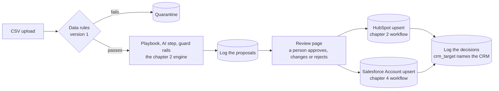

# Chapter 4 notes: the same engine, on Salesforce

KB-135 section 0b, chapter 4: "Runs on your CRM": a second target in a developer org. KB-137 section 6 adds nothing to this chapter. Built 23/11/2026.

## What chapter 4 adds

The chapter 2 workflow, unchanged up to the write, now has a twin that writes to Salesforce. The same data rules, the same playbook, the same AI step and guard rails, the same review page and the same run log; at the end, approved and changed rows become Salesforce Accounts instead of HubSpot companies, each with the same who-decided stamp.

Drawn by hand for these notes. One run writes to one CRM: the workflow you start decides which.

## Done when (KB-135 gives no list for this chapter; these follow its section 6, item 1, and KB-137 A1, for the second target)

| # | Done when | State |
|---|---|---|
| 1 | The same engine writes to Salesforce, with nothing before the write changed, and a test shows the two workflows differ only in the write step | Done: `test_the_salesforce_workflow_differs_from_hubspot_only_in_the_write_step` |
| 2 | The org is set up from one file and checked against it, signed in as the workflow is, including what the login cannot do | Built: [`salesforce/setup.json`](../../salesforce/setup.json), [`scripts/salesforce_setup_check.py`](../../scripts/salesforce_setup_check.py). Waits on the Setup clicks |
| 3 | A sample file runs end to end on Salesforce: rules, AI step, approval, Salesforce, log | Waits on the org setup and one reviewed run |
| 4 | Every Salesforce write carries the stamp (A1.1), one query from a stamp finds its record (A1.2), a changed row keeps both values (A1.3), rejected rows are never written | Built and tested on the harness; `check_run.py --salesforce` proves it on the live run |
| 5 | The login has least reach, and that is recorded on the control sheet | Designed and recorded; proved by the setup check once the org is set up |
| 6 | Tests on every push; these notes with the walk-through | Done |

## What was built

| Item | Where |
|---|---|
| The engine knows two CRM targets. The decisions, stamps and review are the same for both; only the record shape, the batch limit and how the reply is read differ. Engine version 1.1.0 | [`engine/routing.js`](../../engine/routing.js): `CRM_TARGETS`, `salesforceRecord`, `applyDecisions(..., {target})`, `decisionLogRows` |
| The Salesforce workflow, 24 nodes, made by the same script from the same parts. Its only new node is "Salesforce Upsert": an sObject Collections upsert of Accounts on the external ID `Clay_Domain_Key__c`, up to 200 a call, each saved or refused on its own | [`n8n/workflow-v2-salesforce.json`](../../n8n/workflow-v2-salesforce.json), [`scripts/build_n8n_routing.py`](../../scripts/build_n8n_routing.py) |
| What the org needs, in one file: seven Account fields, the permission set, the integration user, the External Client App, the n8n credential | [`salesforce/setup.json`](../../salesforce/setup.json) |
| The org check: scope, user, fields, field access, and reach (no delete; no Leads, Contacts, Opportunities, Cases, Quotes or Users) | [`scripts/salesforce_setup_check.py`](../../scripts/salesforce_setup_check.py), [`scripts/salesforce_client.py`](../../scripts/salesforce_client.py) |
| `check_run.py --salesforce`: the chapter 2 run checks, read back from Salesforce | [`scripts/check_run.py`](../../scripts/check_run.py) |
| Import and drift check through the n8n API: credentials matched by name, the live copy compared with the file | [`scripts/n8n_publish_routing.py`](../../scripts/n8n_publish_routing.py) |
| The run log refuses an unknown CRM target, and each run shows which CRM it wrote to | [`db/run_log.sql`](../../db/run_log.sql): `decisions_crm_target_check`, `run_summary.crm_targets` |
| Setup steps, by who does them | [`chapter-4-build.md`](chapter-4-build.md) |
| Control sheet and role card | [`control-sheet.md`](control-sheet.md), [`role-cards/routing-agent.md`](role-cards/routing-agent.md) |

## Proved so far (23/11/2026)

- **Tests: 234 pass** (176 at the end of chapter 2). New: the two workflows differ only in the write step; the Salesforce write is a PATCH upsert on the external ID, after the review page, with no other path to it; the demo file through every Code node of the Salesforce workflow gives the same decisions and stamps as HubSpot, now as Accounts; one refused record fails only its own row; a refused request fails every write with Salesforce's reason; records use only the fields in `setup.json`; the picklists hold exactly the playbook's codes and owner-team labels; the longest possible stamp fits the 255-character field; the org check fails on a missing field, a wrong type, an unrestricted picklist, a lost external ID, delete rights, any core object, or any other editable custom field; the client never returns the token or shows the secret; the drift check passes n8n's normalised copy and catches a hand edit.
- **The run log**: `setup_run_log.py` applied the new check and column; 9 of 9 login checks still pass.
- **Chapter 2 kept in step.** The engine change touches the five Code nodes chapter 2 runs, so its live copy was updated through the n8n API. First, the drift check read the live copy against the committed chapter 2 file: in step. Then no run was waiting or running; the update kept the trigger's webhook ID; the workflow was published; the form at `/form/gtm-v2-route-leads` answers 200; and the drift check against the new file: in step. HubSpot's write is unchanged: its tests pass as before.
- **n8n's own code, read in the container**: the built-in "Salesforce OAuth2 API" login has a hidden, fixed scope of `full refresh_token`; the general "OAuth2 API" login offers the client-credentials grant, fetches the token at first use and fetches a new one on a 401, even with "never error" set on the node.

Still to prove: the setup check on the real org, the live run and `check_run.py --salesforce`. Those wait on [`chapter-4-build.md`](chapter-4-build.md) parts A to F.

## Choices made, and why

| Choice | Why |
|---|---|
| Accounts, not Leads | The data is company-level, as in version 1 (HubSpot companies). A Salesforce Lead needs a person's last name; making one up would break the "no personal data" rule |
| Upsert on an external ID, `Clay_Domain_Key__c` | The same key as HubSpot's `clay_domain_key`. A second run updates the Account instead of making a copy, so the run is safe to repeat. Salesforce's own uniqueness rule backs the data rule that removes duplicates by domain |
| A second workflow from the same script, not a switch inside one | Chapter 2's proven workflow keeps working if the Salesforce org is closed or switched off, and the claim "only the write differs" is a test, not a sentence |
| sObject Collections with `allOrNone: false` | One call for the batch, as with HubSpot, but each record is saved or refused on its own, so one bad row is logged as failed and the rest are written |
| Client-credentials flow, run as an API-only integration user | No person's login; no consent screen; no refresh token. The user's reach is one permission set: Accounts, read, create and edit, ten fields, no delete. Developer Edition gives one free Salesforce Integration licence for it |
| n8n's general OAuth2 login, not its Salesforce one | n8n's Salesforce login asks for `full refresh_token`, fixed in its code. With client credentials, the app decides the scope: `api` only |
| An External Client App, not a Connected App | Salesforce's current way to make an OAuth app, and the app can admit only holders of the permission set |
| The org's host stays private | It names the org. The committed workflow holds a placeholder; the publish script fills it in from `.env` when it imports |
| Industry is not written to Salesforce | Salesforce's standard Industry list is not HubSpot's, and version 1's mapping is HubSpot's. Writing raw values into an open picklist would make the data dirty, which version 1 exists to stop. A mapping is a later change |
| A missing confidence is sent as null | Salesforce keeps a field that is left out, so an old confidence would stay on the Account when the AI gave no usable proposal this time. HubSpot's write is left as chapter 2 proved it |
| The import goes through the n8n API | No clicks, credentials found by name, the trigger's webhook ID kept, and a drift check that reads the live copy back. The UI import's form-path problem from chapter 2 does not arise |

## Limits met

- **n8n drops parameters that equal a node's default** when it saves a workflow (for example a batch size of 1, or a Code node's default mode). A strict comparison of the live copy with the file therefore always failed. The drift check now treats a key the file sets and n8n does not hold as that default, and still requires every value n8n holds, and every Code node's JavaScript, to match.
- **Salesforce reports errors as a list** (`[{errorCode, message}]`), unlike Claude and HubSpot. The engine read it as "HTTP 401" with no reason until the harness test was written.
- **Salesforce suggests field names with the label's capital letters** (`GTM_route`). The steps say to overwrite them, and the setup check compares exact names.

## How it works (walk-through)

**In 90 seconds**, for a Salesforce-led room. Open on the data, as always.

1. The same company list, the same seven data rules, the same quarantine. Nothing dirty reaches the CRM, whichever CRM it is.
2. The same AI step proposes a team, a priority and a reason from a written playbook, and the same guard rails check it.
3. A person approves, changes or rejects every row. Only then does anything reach Salesforce.
4. Approved rows become Accounts, matched on the company's domain as an external ID, so running the file twice updates the Accounts instead of copying them.
5. Salesforce is reached by an API-only integration user with one permission set: Accounts, create and edit, ten fields, no delete. A script signs in as that user and proves what it cannot do.
6. Every Account carries the stamp: decision, model, playbook version, who decided, when. One query from the stamp finds the full record and the cost.

**In five minutes:** show the two workflows side by side in n8n; they differ in one node. Open `salesforce/setup.json`, then the Account in Salesforce with its stamp, then `check_run.py --stamp`. Then the control sheet row: why not n8n's own Salesforce login (`full` scope), and why not an admin's login.

**The "it went wrong" story for this chapter:** the first drift check said every node of chapter 2's live workflow had changed, though nothing had. n8n leaves out any setting that equals its default when it saves, so a byte-for-byte comparison could never pass. The check now knows that one rule and nothing more: every value n8n holds must still match the file, and the code must match in full.

## Demo checklist

- n8n started with `scripts/n8n_docker.sh`; both routing workflows published.
- `python scripts/salesforce_setup_check.py` passes on the day.
- The Salesforce form at http://localhost:5678/form/gtm-v2-route-leads-salesforce; `skins/lead-routing/sample_run.csv` ready.
- A reviewer label, not a personal name, on the review page in a recording. The org's host is not shown on screen.
- After the run: `python scripts/check_run.py --latest --salesforce`, then one stamp looked up with `--stamp`.
