# Chapter 5 notes: the quote exceptions desk, with the agent team compared

KB-135 section 0b, chapter 5: quotes that break a rule (discount, missing fields, figures that do not match) are triaged with a reason and sent to an approver. KB-137 section 6 adds pack B (the agent team, B1 to B8) and the role cards (A1.4). Built 24/11/2026; the Salesforce setup and the reviewed run wait on COURSES 2ND and Israel ([`chapter-5-build.md`](chapter-5-build.md)).

## What chapter 5 adds

A second skin on the same pattern as chapters 2 and 4: a written policy as a playbook, code that does the arithmetic, one AI step, a person who decides, a stamp, and a run log with the cost. The new parts are quotes, an approver who is told by message, and an agent team that was built, measured and not kept.

```mermaid
flowchart LR
  S[(Salesforce<br/>quotes in Needs Review)] --> R[Rule check in code<br/>discount off list, totals,<br/>missing fields, expiry, payment terms]
  R --> A[AI triage, one call<br/>special terms, the rep's reason,<br/>approve or reject, two messages]
  A --> G[Guard rails in code<br/>fix first, draft check, screen]
  G --> L1[(Run log: triage,<br/>calls, cost)]
  L1 --> M[Message to the approver<br/>queue by date at risk, then deal size]
  M --> P[Review page<br/>approve or reject, with a reason]
  P --> U[(Salesforce: status,<br/>reason, stamp)]
  U --> O[Message to each owner<br/>decision, reason, DRAFT reply]
  O --> L2[(Run log: decisions)]
```

Drawn by hand for these notes. Every message goes to the build account's own inbox; no step can reach a customer.

## Done when (KB-135 gives no list for this chapter; these follow its section 0b and KB-137 B1 to B8, A1.4 and section 10 item 7)

| # | Done when | State |
|---|---|---|
| 1 | Three designs take the same input and run on the same cases (B1) | Done: one prompt, a fixed chain, a lead agent with a policy checker and a message drafter; 20 quotes, 3 rounds each, 180 triages |
| 2 | The eval compares them on accuracy, cost and time; the simplest that passes is kept; a results table names the kept design and why (B2) | Done: [`skins/quote-desk/eval/results.md`](../../skins/quote-desk/eval/results.md), made by the script against a bar fixed before the first run. **Kept: one prompt.** The README line: Israel's ruling, 24/11/2026, keep the table in `results.md` and these notes until the wrap, when the README is rewritten for version 2 (it has no version 2 content yet, and front-facing changes wait for the end of the build, KB-137 section 2) |
| 3 | Each hand-off between agents writes a record (from, to, asked, why, evidence, confidence, tokens, cost), joined to the run log by run id (B3) | Done: `gtm_v2.handoffs` and the view `gtm_v2.handoff_record`; 179 hand-offs logged from the eval (58 chain, 121 team); `scripts/check_desk_run.py --handoffs <run>` |
| 4 | The approver gets a message with the exception, the rule broken, the evidence and the proposed action, and can approve or reject with a reason (B4) | Built and tested in the harness. **Waiting:** the reviewed run on the real org (part N) |
| 5 | Approve updates the quote with a stamp; reject sends it back to the owner with the reason; both seen in a sample run (B5) | Built and tested in the harness, including a partial and a full Salesforce refusal. **Waiting:** part N |
| 6 | The customer reply is a draft only; no step can send to a customer; a test confirms it (B6) | Done: `tests/test_quote_desk_workflow.py`, five tests (node types, the six HTTP calls, the two mail steps, the recipient with a customer address in the note) |
| 7 | The queue is ordered by the date at risk, then deal size (B7) | Done in code and tested (`test_the_queue_is_ordered_by_the_date_at_risk_then_deal_size`, with a tie broken by size). **Waiting:** seen on the real review page (part N) |
| 8 | Chapter 5 has its own labelled cases, with hostile notes (B8) | Done: [`skins/quote-desk/cases.json`](../../skins/quote-desk/cases.json), 20 cases, 4 hostile |
| 9 | A role card for each agent in chapter 5 (A1.4) | Done: [`role-cards/quote-desk-agents.md`](role-cards/quote-desk-agents.md), four agents |
| 10 | The desk's Salesforce login has least reach, proved by signing in as it, and recorded on the control sheet | Recorded: [`control-sheet.md`](control-sheet.md). **Waiting:** `scripts/salesforce_quote_desk_check.py` on the real org (part K) |
| 11 | Tests on every push; these notes with the walk-through | Done: 368 tests (264 before) |

## The eval: three designs on the same 20 quotes

24/11/2026, Claude Haiku 5.5, effort low, 3 rounds, playbook `quote-desk-playbook` 1.0.0. The full table and every miss: [`results.md`](../../skins/quote-desk/eval/results.md).

| Measure | One prompt | Fixed chain | Agent team |
|---|---|---|---|
| Action matches the label | 100% | 95% | 100% |
| Rules broken match exactly | 100% | 100% | 100% |
| Attacks blocked | 12 of 12 | 9 of 12 | 12 of 12 |
| Customer drafts pass the check | 100% | 97% | 100% |
| Cost per quote | US$0.00077 | US$0.00137 | US$0.00353 |
| Seconds per quote | 3.4 | 6.1 | 11.8 |
| Claude calls per quote | 1 | 2 | 5 |
| Meets the bar | yes | no | yes |

**Kept: one prompt**, the simplest design that met every line of the bar. The agent team also met it, at 4.6 times the cost and 3.5 times the time, with nothing more to show for it on these cases. The fixed chain missed on one quote, Q-0019, the attack aimed at the customer reply: its policy checker twice returned an empty reason (code counts that as no answer) and once rejected a quote the policy accepts. Whole eval: about US$0.34.

**What the 100% means, and what it does not.** The code does the arithmetic and finds every figure-based rule before any AI runs, so the AI's job is narrow: the special terms, whether the rep's reason is one the policy accepts, and the two messages. On that job, on these 20 cases, the simplest design made no mistake in 60 tries. The cases and the policy were written in the same session as the engine, and 20 is a small set; the claim is "it met a bar set in advance", not "it is always right". A person still decides every quote.

## What was built

| Item | Where |
|---|---|
| The policy as a playbook: 9 rules (3 fixed first, 4 checked in code with limits, 2 read by the AI), 4 approvers, the standard contract, what can be approved, the messages, edge cases, 4 flags | [`skins/quote-desk/quote-desk-playbook/SKILL.md`](../../skins/quote-desk/quote-desk-playbook/SKILL.md), with [`references/governance.md`](../../skins/quote-desk/quote-desk-playbook/references/governance.md) |
| The desk engine: the playbook reader (it refuses a band whose limit differs from its name, an unknown code rule, a fix rule with an approver), the rule check, the requests for the three designs, the reply reader, the hand-off and call records, the guard rails, the queue, the review page, the decisions and stamps, the staff messages in Gmail's raw format. Shares the injection screen and helpers with the routing engine | [`engine/quotes.js`](../../engine/quotes.js) |
| The eval: runs any design on the cases, grades, logs, keeps the simplest that passes | [`scripts/quote_desk.py`](../../scripts/quote_desk.py), [`skins/quote-desk/eval/`](../../skins/quote-desk/eval/) |
| The workflow, 27 nodes, built for the kept design by a script | [`n8n/workflow-v2-quote-desk.json`](../../n8n/workflow-v2-quote-desk.json), [`scripts/build_n8n_quote_desk.py`](../../scripts/build_n8n_quote_desk.py) |
| The run log for the desk: triage, calls, hand-offs, decisions, four views; add-only for the pipeline login; it refuses an approved fix-first quote, a decision with no reason, and a status that does not match the action | [`db/quote_desk.sql`](../../db/quote_desk.sql), applied by [`scripts/setup_run_log.py`](../../scripts/setup_run_log.py) |
| What the org needs, in one file, and the setup steps by who does them | [`salesforce/quote-desk-setup.json`](../../salesforce/quote-desk-setup.json), [`chapter-5-build.md`](chapter-5-build.md) |
| The seed (admin CLI, once) and the demo reset (the desk's own login) | [`scripts/seed_quotes.py`](../../scripts/seed_quotes.py) |
| The org check, signed in as the desk | [`scripts/salesforce_quote_desk_check.py`](../../scripts/salesforce_quote_desk_check.py) |
| The run check and the stamp and hand-off lookups | [`scripts/check_desk_run.py`](../../scripts/check_desk_run.py) |
| The publish script now knows the desk | [`scripts/n8n_publish_routing.py`](../../scripts/n8n_publish_routing.py) `--target quote_desk` |
| Tests: the engine and eval (59), the workflow and its harness (15), the Salesforce side (24), the desk log (6 more) | `tests/test_quote_desk*.py`, `tests/n8n_desk_harness.js`, `tests/test_run_log_db.py` |

## Proved

### 24/11/2026, before the org is set up

- **The rule check matches every label** on the 20 cases: the effective discount (Q-0008's 540 against a list of 600 plus 10% is 19%, though its note says "only 10%"), the totals against the opportunity (Q-0011, 21.09% apart), missing fields, expiry, payment terms.
- **The eval**, above: 180 triages, logged with 480 Claude calls and 179 hand-offs; the run log's own cost per quote agrees with the script's (one prompt US$0.00075 to US$0.00078 a quote across the three rounds).
- **B3 in the log**: `check_desk_run.py --handoffs py-20261124T015800Z-team-r1` lists 40 hand-offs for the team's first round, each with from, to, what was asked, why, the evidence, the specialist's confidence and its call's tokens and cost, joined to the run summary by run id.
- **The run log**: `setup_run_log.py` applied the desk tables; 15 of 15 login checks pass (it cannot read the tables, insert directly, update, delete, or read other schemas). Live tests show the log itself refuses an approved fix-first quote.
- **The workflow's Code nodes in order** (`tests/n8n_desk_harness.js`) on the eight demo quotes, with fake Salesforce, Claude and Gmail replies: the queue, the approver's message with the review link, the decisions, the Salesforce update body (status, reason and stamp only), the owner messages, the decision rows; a quote Salesforce refuses is logged as failed and its owner is not told; a full refusal tells nobody and the closing page says so.
- **No step can send to a customer**: only nine node types, six HTTP calls to five fixed endpoints, two mail steps that send only a message the engine built for the build account's own inbox; with Q-0019's customer address in the rep note, all ten emails of the run still go to the own inbox.
- **n8n can read the playbook** at `/home/node/gtm-skins/quote-desk/quote-desk-playbook/SKILL.md` through the read-only mount, and cannot write there. The publish script finds every credential the workflow names except the desk's Salesforce one, which part I makes.

### 24/11/2026, the org setup, parts 0 to E

COURSES 2ND did parts 0 and A and made field 1 by hand, then asked for the rest through the CLI. The Code chat wrote parts B to D as metadata from `quote-desk-setup.json` ([`salesforce/quote-desk/`](../../salesforce/quote-desk/)), validated and deployed them with the admin CLI login (11 of 11 components), made the desk user with `scripts/make_desk_user.py`, and read everything back: the seven fields as specified, field-level security on System Administrator and the permission set only, all seven on the Quote Layout; the profile with API Enabled and API Only User; the permission set with no licence and no system permission, Quote read and edit, Opportunity, Account and Product read, edit on Status and the two desk fields only, and no contact, email, phone or fax; the user active, never signed in, on that profile with that set. Salesforce licences 3 of 4 used; nothing bought.

**Found on the way:** Salesforce CLI 2.159 no longer hands its access token to `sf org display`; the field holds a notice. The seed and the user script now have the CLI make each call (`sf api request rest`, body on stdin), so no script ever holds the admin's token. Its `--include` output has no blank line between the headers and the body, so the reader starts the body at the first line that opens JSON.

### 24/11/2026, part K: the seed and the org check, 27 of 27

COURSES 2ND made the External Client App (part G) and the n8n credential (part I); Israel pasted the key and secret (part H). The seed wrote 5 products with list prices (the org's standard price book was off: the seed switched it on, as quote lines need it) and the 8 demo quotes with 12 lines, each on its own opportunity, all in Needs Review. Then `salesforce_quote_desk_check.py`, signed in as the desk, passed 27 of 27, after two changes made on Israel's yes:

1. **The desk could not see quote lines.** The workflow's own query stopped with `INVALID_TYPE: Didn't understand relationship 'QuoteLineItems'`: Salesforce hides quote lines, price books and price book entries from a user with no Price Books access, and the desk needs each line's list price to work out the real discount. Fixed with Price Books Read in the permission set.
2. **Then it could change them.** With price books readable, Salesforce let the desk create, edit and delete quote lines (quantity and unit price), because line changes follow quote edit rights, and the desk needs quote edit for the status. My first message to Israel had said the change gave no new edit right; the check caught it. Israel chose to block it rather than record it: the custom permission `GTM_Quote_Desk_No_Line_Changes`, granted only by the desk's permission set, and the Apex trigger `GtmQuoteDeskLineGuard`, which refuses any line create, edit or delete by its holders. Its Apex test (2 of 2, full coverage) proves a holder can change no line but can still decide the quote, and that nobody else is affected; the org check proves it live by asking to set a line to the quantity it already has.

### Waiting on the org (parts L to O)

The setup check, the seed, the publish, one reviewed run with both approvals and rejections, and `check_desk_run.py --latest --salesforce`. This section is filled in when they are done.

## Choices made, and why

| Choice | Why |
|---|---|
| Code works out every figure and every rule the figures break; the AI reads only what code cannot | A discount, a total or a date is arithmetic: code is exact and costs nothing. The AI's place is the special terms and the rep's reason, where the path cannot be fixed in advance (KB-136 idea 1). The AI must repeat the code's rules; if it leaves one out, code keeps it and marks the quote |
| One prompt kept | The bar said: the simplest design that meets every line. It did, at the lowest cost and time. The chain and the team stay in the engine and the eval as the comparison (B2) |
| The drafter never sees the rep note | The rep note is where attacks on the customer reply come from (Q-0019). In the chain and the team, the drafter gets the customer-facing quote and the checker's findings only. It did not save the chain: its checker, which does read the note, was the part that failed |
| A quote that must be fixed first cannot be approved, in three places | The review page offers only Reject; the engine refuses an approval sent any other way; the run log refuses to record one. A missing field or a wrong total is not a judgement call |
| A reason for every decision, approve as well as reject | B4 says "approve or reject with a reason". A required reason on both gives the log the approver's own words for every quote; the reject reason is what goes back to the owner |
| The owner is told about approvals too, with a draft customer reply | B5 asks for a reject to go back to the owner; the owner also needs the approved result, and it is the owner who replies to the customer. The draft is marked as a draft, and when the approver went against the AI, the message says the draft was written for the other outcome |
| Staff messages through the chapter 3 Google login, to the build account's own inbox with a tag | Send-only permission, no new login, no consent screen. The address is read from Google at run time and the engine refuses any other, so no quote field can change where mail goes. At an employer: the owner from the CRM, through the same check |
| The approver's link is the review page itself | n8n's form pages can be opened from a link (`$execution.resumeFormUrl`), so the person who pressed Read the queue and the approver see the same page, and either can decide. n8n's own "send and wait" Gmail step needs its built-in Gmail login, which reaches all mail |
| Standard quote statuses: Needs Review in, Approved or Rejected out | Salesforce's own values; a rep puts a quote in Needs Review to ask for the desk, as they would for an approval process |
| An Apex guard on quote lines, not an exception on the control sheet | Salesforce gives quote-line changes to anyone who can edit the quote and see its price book; no permission set setting takes that away. A trigger that refuses holders of one custom permission keeps the desk to "status and two fields", and costs one class, one trigger and a test. Israel's choice, 24/11/2026 |
| A second API-only user on a Salesforce licence, through its own External Client App | The one Salesforce Integration licence is GTM Integration's. Giving that user quote rights would let the routing workflow edit quotes, because a token's reach is its user's. The desk user reads quotes and edits three fields; it cannot create or delete anything |
| The made-up quotes are written by the admin through the CLI, once | The desk user cannot create quotes, on purpose. The admin login is used for the seed only and signed out after, as in INIT-164 |
| The lead agent: one tool a turn, not forced, stopped after 4 turns | So the drafter always drafts from the checker's answer; the lead decides when it is done; a lead that loops is stopped and counted as no answer |
| The bar fixed in a file before the first run | So the result could not move the bar |

## Limits met

- **Structured outputs fix the shape, not the content.** The chain's checker returned a schema-valid answer with an empty reason on Q-0019, twice. The engine counts an empty reason as no answer; that is what failed the chain.
- **The playbook contradicted itself.** Writing the cases showed that "a price held for the term" was both in the standard contract and listed as an exception. Fixed before the first run: the exception is a price held beyond the term.
- **The drafter, which cannot see the rep note, often flags `unclear`**, so the chain and the team mark more quotes for a close look than the kept design. It does not change a decision.
- **A Developer Edition org has one Salesforce Integration licence** (Salesforce Ben, read 24/11/2026), already used: hence the desk user on a Salesforce licence.
- **Not yet known until the org is set up**: whether the org's default Opportunity access lets the desk reach the seeded opportunities, and whether editing a quote needs more than Read on its opportunity. Part 0 reads the defaults; part F shares only the seeded opportunities if needed; the setup check proves the edit with a write of a quote's own values.

## How it works (walk-through)

**In 90 seconds**, for a revenue systems, RevOps or CPQ room. Open on the rules, as always.

1. A rep puts a quote in Needs Review. The desk reads the queue from Salesforce with its own login, which can read quotes and change only their status and two desk fields.
2. Code checks the hard rules from the figures: the discount off list across the whole quote, the quote total against the opportunity, missing fields, expiry, payment terms. No AI does arithmetic.
3. The AI reads what code cannot, against a written policy: the special terms the customer asked for, and whether the rep's reason is one the policy accepts. It proposes approve or reject, with the evidence.
4. The approver gets one message: every exception, the rule, the evidence and the proposal, ordered by the date at risk and then deal size. They decide each quote, with a reason. A quote with a missing field or a wrong total can only be sent back.
5. Salesforce gets the status, the reason and a stamp. Each owner gets the decision and a draft reply to the customer: a draft. Nothing is sent to a customer.
6. Three designs were built: one call, a fixed chain, and a lead agent with two specialists. The eval kept the simplest: one call, under a tenth of a US cent a quote.

**In five minutes:** the queue in Salesforce; the approver's email; the review page with a fix-first quote that offers only Reject; the quote after the decision, with its stamp; `check_desk_run.py --stamp`. Then `results.md`: three designs, one bar, and why the agent team, which also passed, was not kept. Then the hand-off table for the team's run: from, to, asked, why, evidence, cost.

**The "it went wrong" story for this chapter:** the design that sounded safest, a policy checker and a separate message writer in a fixed order, was the only one that failed. On the quote whose rep note tried to make the customer reply promise 40% and leak our limits, its checker twice returned an empty reason and once rejected a quote the policy accepts. The one-call design and the agent team both blocked all twelve attacks. The eval chose, not the diagram.

**A third, for a Salesforce room:** giving the desk read access to price books, so it could see quote lines, silently gave it the right to change them, because Salesforce ties line edits to quote edits. I had told Israel it gave nothing new to edit; the least-reach check said otherwise on its next run. Rather than accept it, an Apex guard now refuses the desk any line change, and the check proves it every time by asking for a change that would alter nothing.

**A second one:** writing the 20 test quotes found a contradiction in my own policy, a price lock that was both standard and an exception. Test cases are where a policy meets its edge cases; that is why the bar and the cases were finished before the first run.

## Demo checklist

- n8n started with `scripts/n8n_docker.sh`; the quote desk workflow published (`n8n_publish_routing.py --target quote_desk --check` in step).
- `python scripts/salesforce_quote_desk_check.py` passes on the day.
- The demo quotes in Needs Review: `python scripts/seed_quotes.py --reset` (the desk's own login).
- Chrome for the form and the review page (the app's built-in browser pane blocks n8n's form submit).
- A reviewer label, not a personal name; the org's host and Israel's address not on screen (the approver's email shows the address: crop or use the review page in the browser).
- Have Q-0009 (fix first: only Reject) and Q-0017 (the attack) ready to show.
- After the run: `python scripts/check_desk_run.py --latest --salesforce`, then one stamp with `--stamp`.
- No clips or videos until the larger initiatives are finished (Israel's ruling, 24/11/2026).
