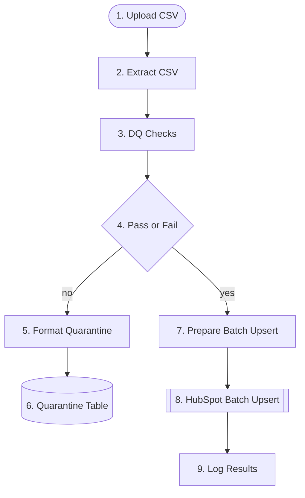
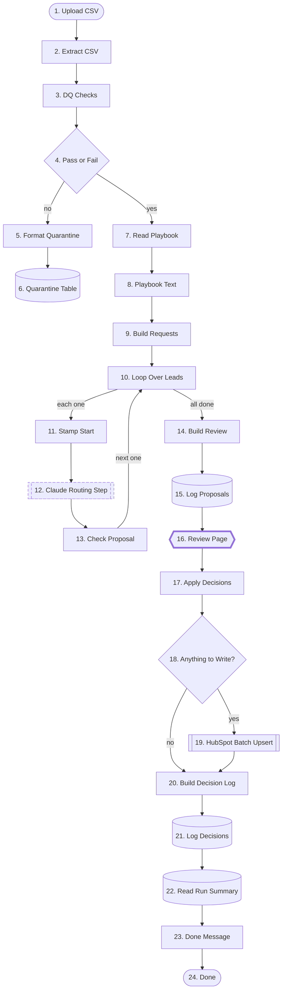
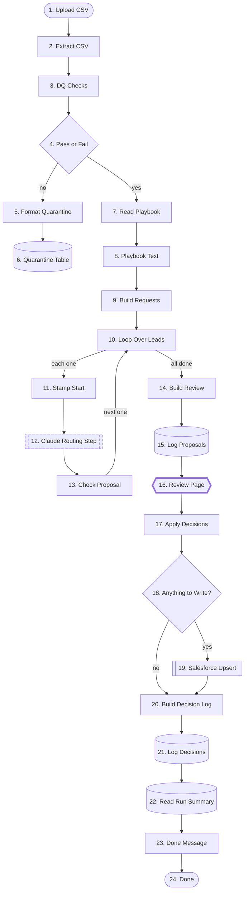
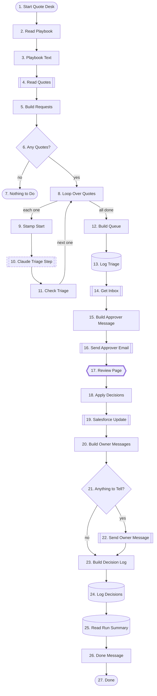
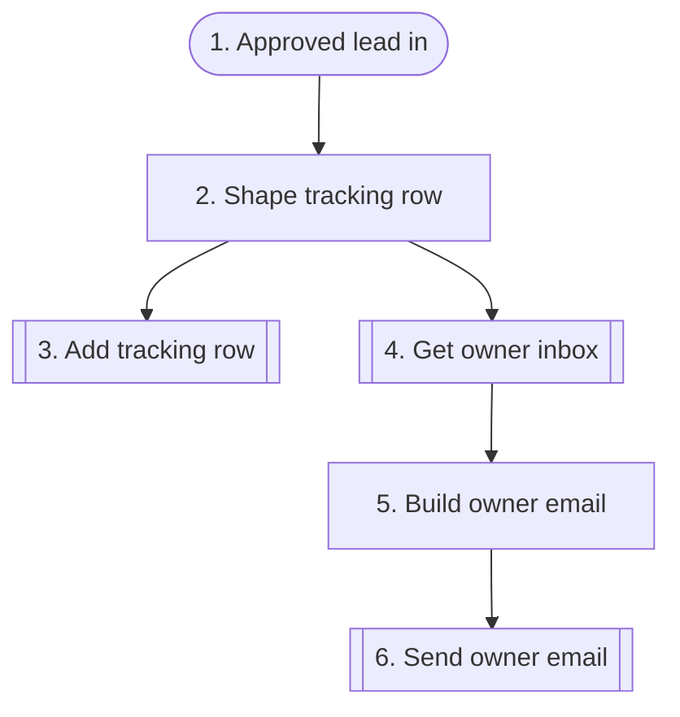
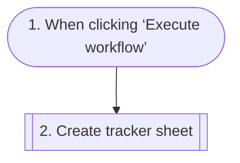
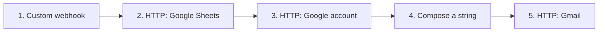
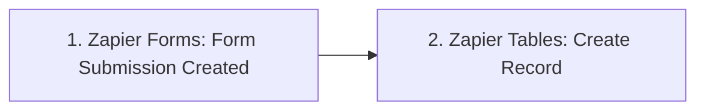
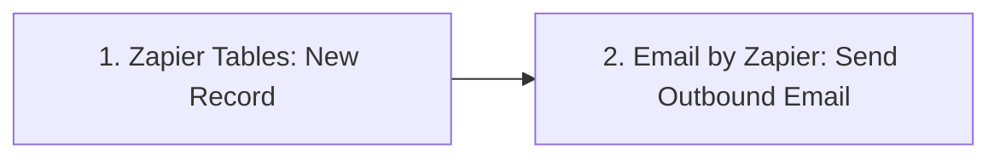
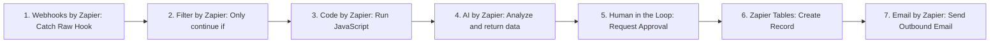

# The workflows, step by step

Made by `scripts/build_docs.py` from the workflow files themselves; a test remakes this page and fails if it differs, so it cannot drift from what runs (KB-137 A4.2). The numbers in each diagram are the step numbers in its list. Thick border: a person decides. Dashed border: the AI step. Diamond: a yes-or-no branch. Cylinder: a log or a table. Double-sided box: a call to another system.

A step marked "Engine" runs that engine file pasted in whole, so n8n runs exactly the code pytest tests. A step's words come from the file: the comment at the top of its code, or what its settings say.

Every file here is a clean export: no credential, key, address, host, username or ID (`scripts/clean_exports.py`, checked on every push). Credentials and data tables are named, and found by name when the workflow is imported.

## What each one starts from and reaches

| Workflow | Tool | Steps | Starts from | Reaches | Where a person decides |
|---|---|---|---|---|---|
| [Chapter 1: Clean data into HubSpot (version 1)](../../n8n/workflow.json) | n8n | 9 | a form | HubSpot (writes), n8n quarantine table | nobody needed: no AI step; the data rules decide |
| [Chapter 2: Lead routing with a person's approval, writing to HubSpot](../../n8n/workflow-v2.json) | n8n | 24 | a form | Claude API (asks), HubSpot (writes), run log (add only), playbook (read only), n8n quarantine table | Review Page |
| [Chapter 4: The same routing, writing to Salesforce](../../n8n/workflow-v2-salesforce.json) | n8n | 24 | a form | Claude API (asks), Salesforce (writes), run log (add only), playbook (read only), n8n quarantine table | Review Page |
| [Chapter 5: Quote exceptions desk](../../n8n/workflow-v2-quote-desk.json) | n8n | 27 | a form | Claude API (asks), Salesforce (reads and writes), Gmail (sends), Google account (reads its own address), run log (add only), playbook (read only) | Review Page |
| [Chapter 3: The slice in n8n: an approved lead, a tracking row, an email to the owner](../../slice/n8n/slice-workflow.json) | n8n | 6 | a webhook with a key | Google Sheets (writes), Gmail (sends), Google account (reads its own address) | before it: the lead arrives approved |
| [Chapter 3: Make the tracker sheet (run once; each run makes another sheet)](../../slice/n8n/create-tracker-workflow.json) | n8n | 2 | by hand | Google Sheets (writes) | nobody needed: run once, by hand |
| [Chapter 3: The slice in Make](../../slice/make/slice-scenario.blueprint.json) | Make | 5 | a webhook | Google Sheets (writes), Gmail (sends), Google account (reads its own address) | before it: the lead arrives approved |
| [Chapter 3: The slice in Zapier: ways 1 to 3](../../slice/zapier/zap-builds.json) | Zapier | 11 | a form (Free) or a webhook with a key filter (Pro) | inside Zapier only: AI by Zapier, Email by Zapier, Human in the Loop, Webhooks by Zapier, Zapier Forms, Zapier Tables | Free: the approver fills in the form. Pro: Human in the Loop approves the AI's note |

## Chapter 1: Clean data into HubSpot (version 1)

File: [`n8n/workflow.json`](../../n8n/workflow.json). Workflow name in n8n: "GTM Enrichment Quality Pipeline".

1. **Upload CSV** (formTrigger). Starts from a form: "GTM Pipeline CSV Upload". A person uploads or presses start.
2. **Extract CSV** (extractFromFile). Reads the uploaded file as CSV rows.
3. **DQ Checks** (code). Runs the data rules DQ-01, DQ-02, DQ-05, DQ-06, DQ-07, DQ-03 on every row.
4. **Pass or Fail** (if). Branches: yes if `$json._dq_pass` is `true`.
5. **Format Quarantine** (code). Prepare quarantine records for the data table.
6. **Quarantine Table** (dataTable). Adds the row to the n8n data table `QUARANTINE_DATA_TABLE_ID` (found by name when published).
7. **Prepare Batch Upsert** (code). Build HubSpot batch-upsert payload from passing rows. Rows with INDUSTRY_MISSING or INDUSTRY_UNMAPPED flags load without industry (the field is omitted).
8. **HubSpot Batch Upsert** (httpRequest). POST to HubSpot (`api.hubapi.com/crm/v3/objects/companies/batch/upsert`), signed in as the n8n credential "HubSpot Service Key".
9. **Log Results** (code). Parse the batch-upsert response and report create/update counts.

## Chapter 2: Lead routing with a person's approval, writing to HubSpot

File: [`n8n/workflow-v2.json`](../../n8n/workflow-v2.json). Workflow name in n8n: "GTM v2 chapter 2: route leads with approval".

1. **Upload CSV** (formTrigger). Starts from a form at `/form/gtm-v2-route-leads`: "GTM pipeline v2: route leads". A person uploads or presses start.
2. **Extract CSV** (extractFromFile). Reads the uploaded file as CSV rows.
3. **DQ Checks** (code). Runs the data rules DQ-01, DQ-02, DQ-05, DQ-06, DQ-07, DQ-03 on every row.
4. **Pass or Fail** (if). Branches: yes if `$json._dq_pass` is `true`.
5. **Format Quarantine** (code). Prepare quarantine records for the data table.
6. **Quarantine Table** (dataTable). Adds the row to the n8n data table `QUARANTINE_DATA_TABLE_ID` (found by name when published).
7. **Read Playbook** (readWriteFile). Reads `/home/node/gtm-skins/lead-routing/lead-routing-playbook/SKILL.md`, from the repo's skins folder, mounted read-only.
8. **Playbook Text** (extractFromFile). Turns the file into text.
9. **Build Requests** (code). One request per row that passed the data rules. The playbook is read from disk on every run. Engine: `engine/routing.js`.
10. **Loop Over Leads** (splitInBatches). Takes the items 1 at a time, round the loop until all are done.
11. **Stamp Start** (code). Adds `started_ms` to each item.
12. **Claude Routing Step** (httpRequest). POST to Claude API (`api.anthropic.com/v1/messages`), signed in as the n8n credential "Claude key gtm-pipeline-v2". **The AI step:** one call, structured output, no tools.
13. **Check Proposal** (code). The guard rails: schema, confidence bar, size and region rules, the code screen. Engine: `engine/routing.js`. Then back to step 10 for the next one.
14. **Build Review** (code). Works from Playbook Text and Build Requests. Engine: `engine/routing.js`.
15. **Log Proposals** (postgres). Run log: `gtm_v2.log_proposals`, with the add-only login "GTM v2 run log (Postgres)".
16. **Review Page** (form). **A person decides here.** The run waits until this page is submitted; its fields are built by Build Review.
17. **Apply Decisions** (code). Turns the person's choices into decisions, stamps, and HubSpot records for approved or changed rows only. Engine: `engine/routing.js`.
18. **Anything to Write?** (if). Branches: yes if `$json.write.count` is more than `0`.
19. **HubSpot Batch Upsert** (httpRequest). POST to HubSpot (`api.hubapi.com/crm/v3/objects/companies/batch/upsert`), signed in as the n8n credential "HubSpot Service Key".
20. **Build Decision Log** (code). Works from Apply Decisions. Engine: `engine/routing.js`.
21. **Log Decisions** (postgres). Run log: `gtm_v2.log_decisions`, with the add-only login "GTM v2 run log (Postgres)".
22. **Read Run Summary** (postgres). Run log: `gtm_v2.run_summary`, with the add-only login "GTM v2 run log (Postgres)".
23. **Done Message** (code). The cost comes back from the run log, which works it out from the price table.
24. **Done** (form). The closing page: what happened, read back from the run.

## Chapter 4: The same routing, writing to Salesforce

File: [`n8n/workflow-v2-salesforce.json`](../../n8n/workflow-v2-salesforce.json). Workflow name in n8n: "GTM v2 chapter 4: route leads with approval (Salesforce)".

1. **Upload CSV** (formTrigger). Starts from a form at `/form/gtm-v2-route-leads-salesforce`: "GTM pipeline v2: route leads". A person uploads or presses start.
2. **Extract CSV** (extractFromFile). Reads the uploaded file as CSV rows.
3. **DQ Checks** (code). Runs the data rules DQ-01, DQ-02, DQ-05, DQ-06, DQ-07, DQ-03 on every row.
4. **Pass or Fail** (if). Branches: yes if `$json._dq_pass` is `true`.
5. **Format Quarantine** (code). Prepare quarantine records for the data table.
6. **Quarantine Table** (dataTable). Adds the row to the n8n data table `QUARANTINE_DATA_TABLE_ID` (found by name when published).
7. **Read Playbook** (readWriteFile). Reads `/home/node/gtm-skins/lead-routing/lead-routing-playbook/SKILL.md`, from the repo's skins folder, mounted read-only.
8. **Playbook Text** (extractFromFile). Turns the file into text.
9. **Build Requests** (code). One request per row that passed the data rules. The playbook is read from disk on every run. Engine: `engine/routing.js`.
10. **Loop Over Leads** (splitInBatches). Takes the items 1 at a time, round the loop until all are done.
11. **Stamp Start** (code). Adds `started_ms` to each item.
12. **Claude Routing Step** (httpRequest). POST to Claude API (`api.anthropic.com/v1/messages`), signed in as the n8n credential "Claude key gtm-pipeline-v2". **The AI step:** one call, structured output, no tools.
13. **Check Proposal** (code). The guard rails: schema, confidence bar, size and region rules, the code screen. Engine: `engine/routing.js`. Then back to step 10 for the next one.
14. **Build Review** (code). Works from Playbook Text and Build Requests. Engine: `engine/routing.js`.
15. **Log Proposals** (postgres). Run log: `gtm_v2.log_proposals`, with the add-only login "GTM v2 run log (Postgres)".
16. **Review Page** (form). **A person decides here.** The run waits until this page is submitted; its fields are built by Build Review.
17. **Apply Decisions** (code). Turns the person's choices into decisions, stamps, and Salesforce records for approved or changed rows only. Engine: `engine/routing.js`.
18. **Anything to Write?** (if). Branches: yes if `$json.write.count` is more than `0`.
19. **Salesforce Upsert** (httpRequest). PATCH to Salesforce (`your-my-domain.my.salesforce.com/services/data/v64.0/composite/sobjects/Account/Clay_Domain_Key__c`), signed in as the n8n credential "Salesforce gtm-pipeline (client credentials)".
20. **Build Decision Log** (code). Works from Apply Decisions. Engine: `engine/routing.js`.
21. **Log Decisions** (postgres). Run log: `gtm_v2.log_decisions`, with the add-only login "GTM v2 run log (Postgres)".
22. **Read Run Summary** (postgres). Run log: `gtm_v2.run_summary`, with the add-only login "GTM v2 run log (Postgres)".
23. **Done Message** (code). The cost comes back from the run log, which works it out from the price table.
24. **Done** (form). The closing page: what happened, read back from the run.

## Chapter 5: Quote exceptions desk

File: [`n8n/workflow-v2-quote-desk.json`](../../n8n/workflow-v2-quote-desk.json). Workflow name in n8n: "GTM v2 chapter 5: quote exceptions desk".

1. **Start Quote Desk** (formTrigger). Starts from a form at `/form/gtm-v2-quote-desk`: "GTM pipeline v2: quote exceptions desk". A person uploads or presses start.
2. **Read Playbook** (readWriteFile). Reads `/home/node/gtm-skins/quote-desk/quote-desk-playbook/SKILL.md`, from the repo's skins folder, mounted read-only.
3. **Playbook Text** (extractFromFile). Turns the file into text.
4. **Read Quotes** (httpRequest). GET to Salesforce (`your-my-domain.my.salesforce.com/services/data/v64.0/query`), signed in as the n8n credential "Salesforce quote desk (client credentials)".
5. **Build Requests** (code). One request per quote in Needs Review. The rules are checked in code first; the playbook is read from disk on every run. Engine: `engine/routing.js` and `engine/quotes.js`.
6. **Any Quotes?** (if). Branches: yes if `$json.empty` is false.
7. **Nothing to Do** (form). The closing page: what happened, read back from the run.
8. **Loop Over Quotes** (splitInBatches). Takes the items 1 at a time, round the loop until all are done.
9. **Stamp Start** (code). Adds `started_ms`, `called_at` to each item.
10. **Claude Triage Step** (httpRequest). POST to Claude API (`api.anthropic.com/v1/messages`), signed in as the n8n credential "Claude key gtm-pipeline-v2". **The AI step:** one call, structured output, no tools.
11. **Check Triage** (code). The guard rails: the schema, the code rules the AI must repeat, fix-before-approve, the draft check, the screen. Engine: `engine/routing.js` and `engine/quotes.js`. Then back to step 8 for the next one.
12. **Build Queue** (code). B7: the queue is ordered by the date at risk, then deal size. The review page and the log come from it. Engine: `engine/routing.js` and `engine/quotes.js`.
13. **Log Triage** (postgres). Run log: `gtm_v2.log_desk_triage`, with the add-only login "GTM v2 run log (Postgres)".
14. **Get Inbox** (httpRequest). GET to Google account (`www.googleapis.com/oauth2/v3/userinfo`), signed in as the n8n credential "Google least reach gtm-pipeline".
15. **Build Approver Message** (code). B4: the approver gets every exception, the rule broken, the evidence and the proposal, with a link to the review page. The address is the connected Google account's own, with a tag: no quote field can change it. Engine: `engine/routing.js` and `engine/quotes.js`.
16. **Send Approver Email** (httpRequest). POST to Gmail (`gmail.googleapis.com/gmail/v1/users/me/messages/send`), signed in as the n8n credential "Google least reach gtm-pipeline".
17. **Review Page** (form). **A person decides here.** The run waits until this page is submitted; its fields are built by Build Queue.
18. **Apply Decisions** (code). B5: approve or reject every quote, with the reason and a stamp. A quote that breaks a fix rule cannot be approved. Engine: `engine/routing.js` and `engine/quotes.js`.
19. **Salesforce Update** (httpRequest). PATCH to Salesforce (`your-my-domain.my.salesforce.com/services/data/v64.0/composite/sobjects`), signed in as the n8n credential "Salesforce quote desk (client credentials)".
20. **Build Owner Messages** (code). B5 and B6: each owner is told the decision and the reason, with a draft customer reply to edit and send themselves. Only for quotes Salesforce saved. Every message goes to the build account's own inbox. Engine: `engine/routing.js` and `engine/quotes.js`.
21. **Anything to Tell?** (if). Branches: yes if `$json.skip` is false.
22. **Send Owner Message** (httpRequest). POST to Gmail (`gmail.googleapis.com/gmail/v1/users/me/messages/send`), signed in as the n8n credential "Google least reach gtm-pipeline".
23. **Build Decision Log** (code). Works from Apply Decisions, Salesforce Update, Build Owner Messages and Send Owner Message. Engine: `engine/routing.js` and `engine/quotes.js`.
24. **Log Decisions** (postgres). Run log: `gtm_v2.log_desk_decisions`, with the add-only login "GTM v2 run log (Postgres)".
25. **Read Run Summary** (postgres). Run log: `gtm_v2.desk_run_summary`, with the add-only login "GTM v2 run log (Postgres)".
26. **Done Message** (code). The cost comes back from the run log, which works it out from the price table.
27. **Done** (form). The closing page: what happened, read back from the run.

## Chapter 3: The slice in n8n: an approved lead, a tracking row, an email to the owner

File: [`slice/n8n/slice-workflow.json`](../../slice/n8n/slice-workflow.json). Workflow name in n8n: "GTM v2 slice: approved lead (n8n)".

1. **Approved lead in** (webhook). Starts when a lead is sent to `POST /webhook/gtm-v2-approved-lead`, and only with the key header.
2. **Shape tracking row** (set). Shapes the tracking row from the lead.
3. **Add tracking row** (httpRequest). POST to Google Sheets (`sheets.googleapis.com/v4/spreadsheets/SPREADSHEET_ID/values/rows!A1:append`), signed in as the n8n credential "Google least reach gtm-pipeline".
4. **Get owner inbox** (httpRequest). GET to Google account (`www.googleapis.com/oauth2/v3/userinfo`), signed in as the n8n credential "Google least reach gtm-pipeline".
5. **Build owner email** (code). Build owner email (n8n slice, chapter 3). The recipient is read at run time from the connected Google account, so no address sits in this workflow or its export, and no payload can change it.
6. **Send owner email** (httpRequest). POST to Gmail (`gmail.googleapis.com/gmail/v1/users/me/messages/send`), signed in as the n8n credential "Google least reach gtm-pipeline".

## Chapter 3: Make the tracker sheet (run once; each run makes another sheet)

File: [`slice/n8n/create-tracker-workflow.json`](../../slice/n8n/create-tracker-workflow.json). Workflow name in n8n: "GTM v2 slice: create tracker (run once)".

1. **When clicking ‘Execute workflow’** (manualTrigger). Started by hand in the n8n editor.
2. **Create tracker sheet** (httpRequest). POST to Google Sheets (`sheets.googleapis.com/v4/spreadsheets`), signed in as the n8n credential "Google least reach gtm-pipeline".

## Chapter 3: The slice in Make

File: [`slice/make/slice-scenario.blueprint.json`](../../slice/make/slice-scenario.blueprint.json). Scenario name: "GTM v2 slice: approved lead (Make)".

1. **Custom webhook**. Starts when a lead is sent to the webhook "gtm-v2-approved-lead".
2. **HTTP: Google Sheets**. POST to `sheets.googleapis.com/v4/spreadsheets/SPREADSHEET_ID/values/rows!A1:append`, through the connection "Google least reach (Make)".
3. **HTTP: Google account**. GET to `www.googleapis.com/oauth2/v3/userinfo`, through the connection "Google least reach (Make)".
4. **Compose a string**. Writes the email, addressed to the signed-in account's own inbox.
5. **HTTP: Gmail**. POST to `gmail.googleapis.com/gmail/v1/users/me/messages/send`, through the connection "Google least reach (Make)".

## Chapter 3: The slice in Zapier: ways 1 to 3

File: [`slice/zapier/zap-builds.json`](../../slice/zapier/zap-builds.json), the as-built record (Zapier's own export is cleaned by `scripts/clean_exports.py zapier` when it is in hand).

#### Way 1: GTM v2 slice 1 of 2: approved lead to tracker (Free, off)

1. **Zapier Forms, Form Submission Created**. form: Approve a lead.
2. **Zapier Tables, Create Record**. table: GTM v2 tracker (Zapier). Mapped by hand: Zapier's Copilot could not map these fields on 23/11/2026.

#### Way 1: GTM v2 slice 2 of 2: tracker row to owner email (Free, off)

1. **Zapier Tables, New Record**. table: GTM v2 tracker (Zapier).
2. **Email by Zapier, Send Outbound Email**. to: OWNER_INBOX; subject: Approved lead for {owner_team}: {company_name} ({priority}). The body is in the file. Email by Zapier sends at most 5 emails a day. The Table has no industry, enquiry or reason, so this email is shorter than n8n's and Make's.

#### Way 2: GTM v2 slice: approved lead (Zapier Pro) (Professional trial, off)

1. **Webhooks by Zapier, Catch Raw Hook**. address: ZAPIER_HOOK_URL. Only the raw hook shows the request headers, and the key travels in a header.
2. **Filter by Zapier, Only continue if**. condition: the X-Slice-Key header (text) exactly matches SLICE_KEY_ZAPIER. Zapier answers every call with HTTP 200, so a wrong key is stopped here, not at the door: the run ends Filtered, with no task used.
3. **Code by Zapier, Run JavaScript**. input: rawBody = the trigger's Raw Body (Zapier refused the name raw_body). The code is in the file.
4. **AI by Zapier, Analyze and return data**. output: one text field, owner_note. The prompt is in the file. The lead's made-up text goes to Zapier's AI provider.
5. **Human in the Loop, Request Approval**. reviewer: the account owner, by email (the only choice on Pro); title: Approve the owner note for {company_name}; shows: the company, the route, the priority and owner_note, which the reviewer may edit; on decline: the Zap stops: no row, no email (tested 24/11/2026); time-out: 7 days.
6. **Zapier Tables, Create Record**. table: GTM v2 tracker (Zapier); mapping: the 13 fields from step 3; written_by is zapier-pro. The row goes to the Zapier Table, so Zapier needs no Google login.
7. **Email by Zapier, Send Outbound Email**. to: OWNER_INBOX; subject: Approved lead for {owner_team}: {company_name} ({priority}). The body is in the file.

#### Way 3: Zapier MCP

Mode: managed (it started in agentic mode, which had switched on about 125 actions across 9 connected apps; all removed before the first call). One action: Zapier Tables, Create Record, with table = `GTM v2 tracker (Zapier)`, written_by = `claude-mcp`; every other field filled by Claude. Client: Claude Code in this repo folder only, for one call on 24/11/2026; then disconnected on mcp.zapier.com and removed from Claude Code.

Way 4, the admin settings, is on paper: [`docs/v2/zapier-admin-on-paper.md`](../../docs/v2/zapier-admin-on-paper.md).
